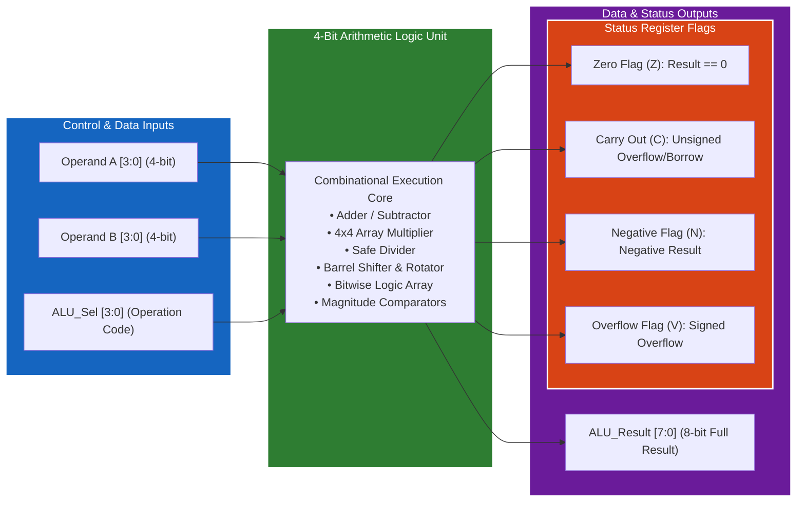

<div align="center">

# ⚡ 4-Bit Arithmetic Logic Unit (ALU) in Verilog HDL
### Synthesizable 16-Operation RTL Processor Datapath with Full Status Flag Register

[-00599C?style=for-the-badge&logo=microchip&logoColor=white)](https://en.wikipedia.org/wiki/Verilog)
[](#rtl-block-diagram)
[](#-complete-16-operation-truth-table)
[](#flag-generation-logic)
[](https://steveicarus.github.io/iverilog/)
[-008080?style=for-the-badge)](#simulation--waveform-viewing)
[](LICENSE)

<br/>

<p align="center">
  <b>A production-grade digital VLSI hardware design modeling the core processing element of a CPU datapath.</b><br/>
  Implements 16 arithmetic, bitwise logic, circular rotate, and relational comparison operations with status flags (Zero, Carry, Negative, Overflow) and a self-checking testbench.
</p>

</div>

---

## 🛠️ Technology Stack & EDA Tooling

<table>
  <tr>
    <td align="center" width="25%"><b>Domain</b></td>
    <td align="center"><b>Technologies & Colorful Cards</b></td>
  </tr>
  <tr>
    <td align="center"><b>Hardware Description</b></td>
    <td>
      
      
      
    </td>
  </tr>
  <tr>
    <td align="center"><b>EDA Simulators</b></td>
    <td>
      
      
      
    </td>
  </tr>
  <tr>
    <td align="center"><b>Waveform Viewers</b></td>
    <td>
      
      
    </td>
  </tr>
  <tr>
    <td align="center"><b>Verification Stack</b></td>
    <td>
      
      
    </td>
  </tr>
  <tr>
    <td align="center"><b>Build Automation</b></td>
    <td>
      
      
    </td>
  </tr>
</table>

---

## 🔲 RTL Block Diagram



---

## 📋 Complete 16-Operation Truth Table

The unit executes 16 micro-operations selected via the 4-bit `ALU_Sel` bus:

| `ALU_Sel` | Operation Name | Mathematical / RTL Logic | Result Bit Width | Status Flags Affected |
| :---: | :--- | :--- | :---: | :--- |
| `4'b0000` | **Addition** | `A + B` | 8-bit | $Z, C, V$ |
| `4'b0001` | **Subtraction** | `A - B` | 8-bit | $Z, C\text{ (Borrow)}, N, V$ |
| `4'b0010` | **Multiplication** | `A * B` (Full $15 \times 15 = 225$) | 8-bit | $Z$ |
| `4'b0011` | **Division** | `(B != 0) ? (A / B) : 0` | 8-bit | $Z$ |
| `4'b0100` | **Logical Shift Left** | `A << 1` | 8-bit | $Z$ |
| `4'b0101` | **Logical Shift Right** | `A >> 1` | 8-bit | $Z$ |
| `4'b0110` | **Rotate Left (ROL)** | `{A[2:0], A[3]}` | 8-bit | $Z$ |
| `4'b0111` | **Rotate Right (ROR)** | `{A[0], A[3:1]}` | 8-bit | $Z$ |
| `4'b1000` | **Bitwise AND** | `A & B` | 8-bit | $Z$ |
| `4'b1001` | **Bitwise OR** | `A \| B` | 8-bit | $Z$ |
| `4'b1010` | **Bitwise XOR** | `A ^ B` | 8-bit | $Z$ |
| `4'b1011` | **Bitwise NOR** | `~(A \| B)` | 8-bit | $Z$ |
| `4'b1100` | **Bitwise NAND** | `~(A & B)` | 8-bit | $Z$ |
| `4'b1101` | **Bitwise XNOR** | `~(A ^ B)` | 8-bit | $Z$ |
| `4'b1110` | **Greater Than** | `(A > B) ? 8'd1 : 8'd0` | 8-bit | $Z$ |
| `4'b1111` | **Equal To** | `(A == B) ? 8'd1 : 8'd0` | 8-bit | $Z$ |

---

## 🚩 Flag Generation Logic

Modern processor architectures (such as ARM, RISC-V, and x86) use flags to execute conditional branch instructions (`BEQ`, `BNE`, `BLT`, etc.):

1. **Zero Flag ($Z$)**:
   $$\text{Zero\_Flag} = (\text{ALU\_Result} == 8\text{'d0})$$
   Asserts high whenever the operation generates a null result.
2. **Carry / Borrow Flag ($C$)**:
   $$\text{Carry\_Out} = (\text{ALU\_Sel} == 4\text{'b0000}) \ ?\ (A + B > 15) : (\text{ALU\_Sel} == 4\text{'b0001}) \ ?\ (A < B) : 1\text{'b0}$$
   Captures the 5th overflow bit during addition and acts as an active-high Borrow flag during unsigned subtraction.
3. **Negative Flag ($N$)**:
   Asserts if a subtraction causes underflow ($A < B$).
4. **Overflow Flag ($V$)**:
   Detects signed two's complement arithmetic overflow:
   - **Addition Overflow**: Occurs when adding two operands of identical sign produces a sum with the opposite sign:
     $$V_{add} = \overline{(A[3] \oplus B[3])} \cdot (A[3] \oplus \text{Result}[3])$$
   - **Subtraction Overflow**: Occurs when subtracting opposite signs produces an inverted result sign:
     $$V_{sub} = (A[3] \oplus B[3]) \cdot (A[3] \oplus \text{Result}[3])$$

---

## 📁 Repository Organization

```text
Verilog-4Bit-ALU/
├── 📁 rtl/
│   └── alu.v                         # Synthesizable 4-bit ALU with status flags
├── 📁 tb/
│   └── alu_tb.v                      # Automated self-checking testbench
├── 📁 sim/
│   ├── run_sim.bat                   # Automated simulation runner for Windows
│   └── Makefile                      # Compilation & waveform runner for Linux/macOS
├── 📄 .gitignore                     # Ignores *.vcd, *.vvp, and EDA cache directories
└── 📄 README.md                      # Documentation with truth tables, schematics & cards
```

---

## 🚀 Simulation & Waveform Viewing

### Method 1: Using Icarus Verilog & GTKWave (Local)
#### On Windows:
Double-click `sim/run_sim.bat` or run:
```powershell
cd sim
iverilog -o alu_sim.vvp ..\rtl\alu.v ..\tb\alu_tb.v
vvp alu_sim.vvp
gtkwave dump.vcd
```

#### On Linux / macOS:
```bash
cd sim
make
make wave
```

---

### Method 2: Zero-Install in Browser (EDA Playground)
1. Go to **[edaplayground.com](https://www.edaplayground.com/)**.
2. Select **Icarus Verilog 0.10.0** as the simulator.
3. Check the **"Open EPWave after run"** box.
4. Paste `rtl/alu.v` on the left pane and `tb/alu_tb.v` on the right pane.
5. Click **Run** to view live simulation logs and graphical waveforms!

---

## 💻 Sample Simulation Console Output

```text
================================================================================
                 STARTING COMPREHENSIVE 4-BIT ALU TESTBENCH                     
================================================================================
[PASS] Addition (10 + 5)       | A=10 (4'b1010), B=5 (4'b0101) => Result=15 (8'b00001111) | Z=0 C=0 N=0 V=0
[PASS] Addition with Carry (15+15) | A=15 (4'b1111), B=15 (4'b1111) => Result=30 (8'b00011110) | Z=0 C=1 N=0 V=0
[PASS] Addition Zero Flag (0+0) | A=0 (4'b0000), B=0 (4'b0000) => Result=0 (8'b00000000) | Z=1 C=0 N=0 V=0
[PASS] Subtraction (12 - 4)     | A=12 (4'b1100), B=4 (4'b0100) => Result=8 (8'b00001000) | Z=0 C=0 N=0 V=0
[PASS] Subtraction Zero (7 - 7) | A=7 (4'b0111), B=7 (4'b0111) => Result=0 (8'b00000000) | Z=1 C=0 N=0 V=0
[PASS] Subtraction Borrow (3-8) | A=3 (4'b0011), B=8 (4'b1000) => Result=5 (8'b00000101) | Z=0 C=1 N=1 V=0
[PASS] Multiplication (3 x 4)   | A=3 (4'b0011), B=4 (4'b0100) => Result=12 (8'b00001100) | Z=0 C=0 N=0 V=0
[PASS] Max Multiplication 15x15 | A=15 (4'b1111), B=15 (4'b1111) => Result=225 (8'b11100001) | Z=0 C=0 N=0 V=0
[PASS] Division (15 / 3)        | A=15 (4'b1111), B=3 (4'b0011) => Result=5 (8'b00000101) | Z=0 C=0 N=0 V=0
[PASS] Divide-by-Zero Guard     | A=10 (4'b1010), B=0 (4'b0000) => Result=0 (8'b00000000) | Z=1 C=0 N=0 V=0
[PASS] Shift Left (0101 << 1)   | A=5 (4'b0101), B=0 (4'b0000) => Result=10 (8'b00001010) | Z=0 C=0 N=0 V=0
[PASS] Shift Right (1011 >> 1)  | A=11 (4'b1011), B=0 (4'b0000) => Result=5 (8'b00000101) | Z=0 C=0 N=0 V=0
[PASS] Rotate Left (1001 ROL)   | A=9 (4'b1001), B=0 (4'b0000) => Result=3 (8'b00000011) | Z=0 C=0 N=0 V=0
[PASS] Rotate Right (1001 ROR)  | A=9 (4'b1001), B=0 (4'b0000) => Result=12 (8'b00001100) | Z=0 C=0 N=0 V=0
[PASS] Bitwise AND (1100 & 1010)| A=12 (4'b1100), B=10 (4'b1010) => Result=8 (8'b00001000) | Z=0 C=0 N=0 V=0
[PASS] Bitwise OR  (1100 | 1010)| A=12 (4'b1100), B=10 (4'b1010) => Result=14 (8'b00001110) | Z=0 C=0 N=0 V=0
[PASS] Bitwise XOR (1100 ^ 1010)| A=12 (4'b1100), B=10 (4'b1010) => Result=6 (8'b00000110) | Z=0 C=0 N=0 V=0
[PASS] Bitwise NOR ~(1100|1010) | A=12 (4'b1100), B=10 (4'b1010) => Result=1 (8'b00000001) | Z=0 C=0 N=0 V=0
[PASS] Bitwise NAND~(1100&1010) | A=12 (4'b1100), B=10 (4'b1010) => Result=7 (8'b00000111) | Z=0 C=0 N=0 V=0
[PASS] Bitwise XNOR~(1100^1010) | A=12 (4'b1100), B=10 (4'b1010) => Result=9 (8'b00001001) | Z=0 C=0 N=0 V=0
[PASS] Greater Than (12 > 8)    | A=12 (4'b1100), B=8 (4'b1000) => Result=1 (8'b00000001) | Z=0 C=0 N=0 V=0
[PASS] Equal To (7 == 7)        | A=7 (4'b0111), B=7 (4'b0111) => Result=1 (8'b00000001) | Z=0 C=0 N=0 V=0
================================================================================
                        SIMULATION TEST RESULTS SUMMARY                         
================================================================================
  TOTAL TESTS EXECUTED : 22
  TESTS PASSED         : 22
  TESTS FAILED         : 0
  STATUS               : ALL TESTS PASSED SUCCESSFULLY! (100% VERIFIED)
================================================================================
```

---

## 🎓 Viva & Digital Design Interview Notes

<details>
<summary><b>Click to expand Viva Q&A Cheat Sheet</b></summary>
<br/>

1. **Why is `default` mandatory inside a Verilog `case` statement?**
   - In combinational logic (`always @(*)`), if an input combination does not specify an output assignment, synthesis tools infer a **transparent latch** to preserve the previous value. The `default` branch ensures all outputs are assigned, guaranteeing pure combinational multiplexer hardware.

2. **Why must the multiplication result register be 8 bits wide for two 4-bit operands?**
   - Multiplying two $n$-bit binary numbers produces a maximum product of $(2^n - 1)^2$. For $n = 4$: $15 \times 15 = 225$. Since $2^7 - 1 = 127 < 225 \le 2^8 - 1 = 255$, exactly $2n = 8$ bits are mathematically required to prevent upper bit truncation.

3. **How does circular rotation differ from logical shifting in hardware?**
   - A **logical shift** discards displaced bits and pads vacant positions with zeros ($0$). A **circular rotate** routes outgoing bits back into the vacant positions via direct wire routing (`{A[2:0], A[3]}`), requiring zero additional logic gates.

4. **What is the difference between Carry Flag ($C$) and Overflow Flag ($V$)?**
   - The **Carry Flag** indicates unsigned arithmetic overflow (when a sum exceeds $2^n - 1$).
   - The **Overflow Flag** indicates signed two's complement overflow (when adding two positives yields a negative, or two negatives yields a positive).

</details>

---

<div align="center">
  <sub>Developed by Ayush Raj • Built with ❤️ for VLSI & Digital System Design</sub>
</div>
